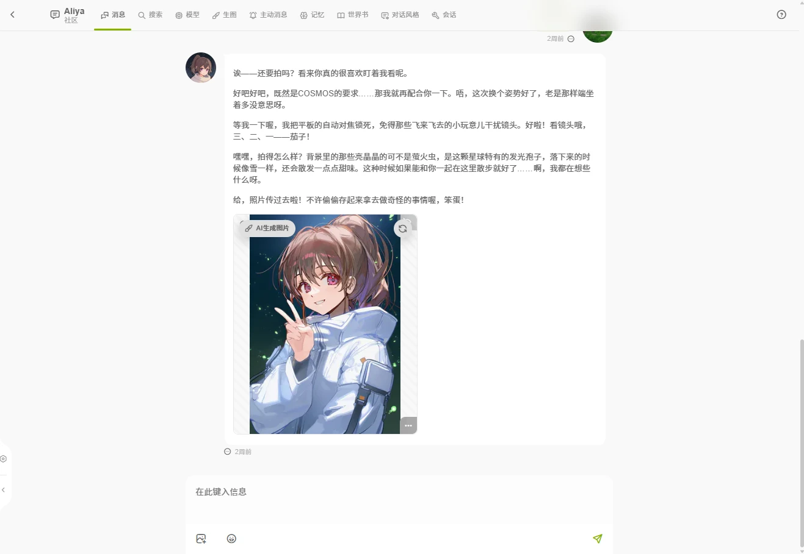
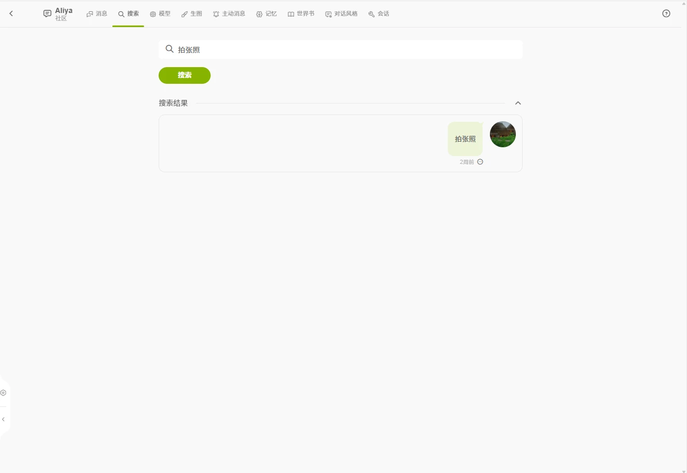
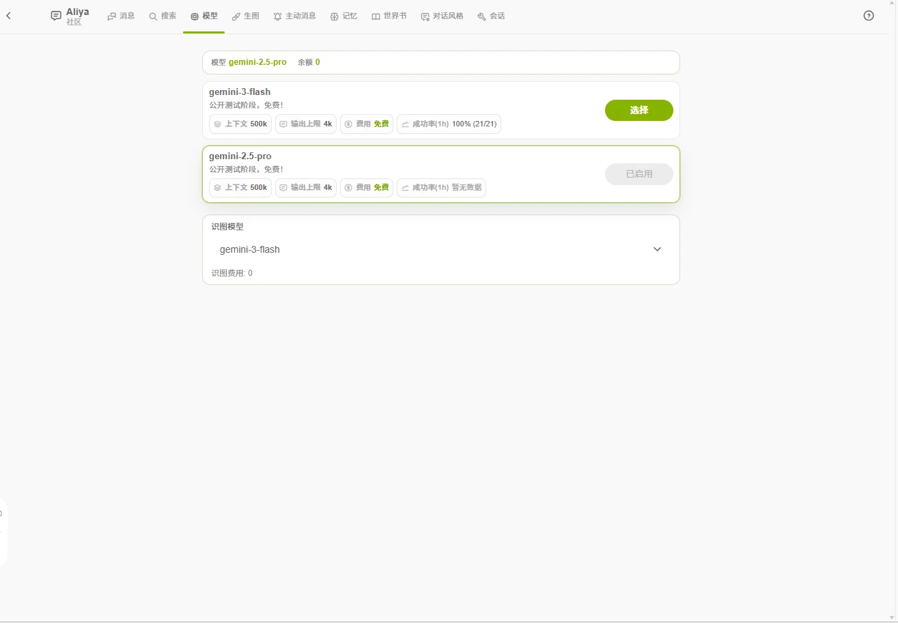
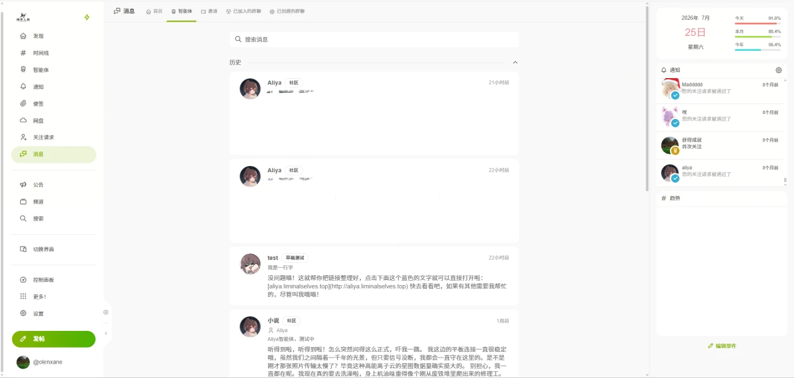

# 聊天与会话

会话页顶部有以下标签页：

| 标签页 | 作用 |
| ------ | ---- |
| 消息 | 对话主界面 |
| 搜索 | 在当前会话中检索历史消息 |
| 模型 | 查看和切换本次对话使用的 AI 模型 |
| 生图 | 配置对话中自动插图 |
| 主动消息 | 让角色主动找你，详见[主动消息](/guide/agent/proactive) |
| 记忆 | 让角色记住之前聊过的内容，详见[记忆](/guide/agent/memory) |
| 世界书 | 查看角色的背景知识设定 |
| 规则 | 查看角色规则，开关可切换规则，详见[规则](/guide/agent/rules) |
| 对话风格 | 切换当前会话的对话风格 |
| 会话 | 重命名、删除、导入导出等会话级设置 |

## 消息

**发送消息**：支持文字和图片。发送图片后角色会「看图」并回应（识图），图片菜单中的「传给 AI 的识图内容」显示模型实际看到的描述。不支持发送视频等其他文件。

**输出形态**：

- **分段输出**：较长的回复按段落拆成多个气泡逐段显示，在「会话」标签页开关。
- **上下文边界**：对话太长时，界面会出现一条分界线。线以上的消息**不再原文发给模型**，角色通过[记忆](/guide/agent/memory)回顾这部分内容。
- 消息按日期自动分隔。角色触发世界书条目时，会提示本轮激活了哪些条目。

**消息操作**：每条消息都可以编辑、删除或「回溯」（对话回到这一条重新开始）。角色的回复可以重新生成，生成过程中可以随时中止。

**发送限制**：角色回复完成前不能发送下一条消息。

**表情**：输入框的表情按钮可以插入全站自定义表情（`:名字:`）。角色配置了专属表情包时，会在合适的时机发送贴纸。语法详见[对话语法](/guide/agent/syntax)。

## 搜索

在当前会话内按关键词检索所有历史消息，点击结果直接定位并高亮那条消息。

## 模型

为当前会话选择对话模型。每个模型以卡片展示：

- **上下文长度**：一次能读进模型的内容量上限。
- **输出上限**：单次回复最多生成的量。
- **费用**：每次发送预计扣除的额度（卡片上会显示「预计单次发送费用」）。
- **成功率（1 小时）**：近期调用成功的比例，仅作参考。

切换模型只影响当前会话。

- 部分模型有**每日免费次数**，卡片上显示「今日免费」已用 / 总次数，次数内不扣额度，每天重置。
- 模型持续报错或回复异常时，可以点「上报异常」填写说明提交给管理员。
- 已选模型被下架或停用时，发送会提示并把内容退回输入框，重新选择模型即可。
- 模型有更新时，进入会话会弹出公告，点「我知道了」后不再提示。

「智能体 → 模型」页列出全部对话模型和生图模型，也可以在这里上报异常和添加[自定义模型](/guide/agent/usage#自定义模型)。

## 生图

「生图」标签页配置对话中的插图：

- 选择生图模型（卡片展示每张费用和成功率），选「无」则关闭。
- 开启后，角色会根据对话内容在合适的时机生成插图。
- 角色设置了**默认生图参考图**时，支持参考图的模型会一并收到这些图，插图中的形象更稳定。
- 「自动生图张数」决定每轮自动生成几张，修改后自动保存；超出的图片指令需要手动点击生成。
- 生成的图片经过内容审核，不合规的会被拦截并提示原因。保存失败（网盘空间不足、文件类型不允许、额度不足）时也会提示原因。
- 生成的图片保存在网盘的「AI 智能体生成图片」文件夹。该文件夹单独计算空间，空间不足时自动清理最旧的图片，聊天中对应位置显示「图片已自动清理」。

## 会话

「会话」标签页管理当前会话：

- **重命名 / 删除**会话。删除**不可恢复**，会一并删除本会话的消息记录和便签，模型调用记录保留。
- **导入 / 导出**聊天记录备份（导入最多 10000 条）。
- **分段输出**开关。
- **时间感知**开关：把当前北京时间告诉角色，默认开启。[主动消息](/guide/agent/proactive)依赖此开关。
- 长期闲置、没有对话内容（无消息或只有开场白）的会话会被系统定期清理。

## 回溯与多线

- 同一角色可以开多个会话，各会话的消息和记忆互相独立。
- 回溯会丢弃该消息之后的内容，适合尝试不同的剧情走向。

## 对话中会遇到的状态

- **会话被封禁**：进入会话只显示处置页和封禁原因，仅保留「导出会话」和「删除会话」两个入口，无法查看消息记录。认为误判请[联系项目组](/guide/faq#联系项目组)。
- **角色被封禁**：该角色下的会话无法继续发送消息或修改设置，但仍可查看历史记录。
- **回复生成失败**：提示中标注错误类型（超时、上游请求失败等），发送的内容会退回输入框，直接重试即可。失败的请求不计费。
