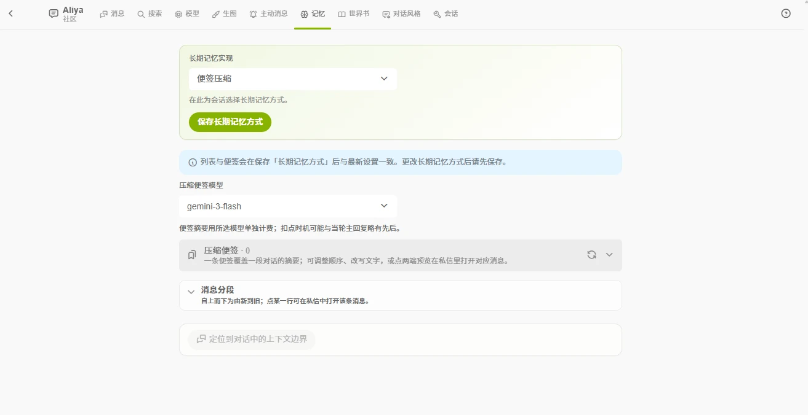

# 记忆

对话变长后，较早的消息会超出模型的上下文窗口，界面上出现[上下文边界](/guide/agent/chat#消息)。记忆功能让角色回顾边界以外的内容。

记忆按**单个会话**独立开启，在「记忆」标签页的「长期记忆实现」中选择「便签压缩」或「关闭」。

## 便签压缩

AI 模型把较早的对话压缩成一条条「便签」摘要，对话超出上下文窗口后，角色通过便签回顾之前的内容。

- 每条便签覆盖一段对话区间，可以点开查看起止消息并跳转定位。
- 便签支持**手动编辑、调整顺序、删除**。删除后，对应区间的消息会重新以原文进入对话历史。
- 便签有状态：生成中 / 参与回复 / 休眠中 / 失败。压缩失败时会在会话中提示，可整体重试；已生成的便签可以手动编辑修正。
- 「记忆」页有消息分段总览，自上而下由新到旧，显示哪些消息在窗口内、哪些在排队、哪些已被总结。
- 可以为会话单独选择**压缩模型**，便签摘要按所选模型**单独计费**（扣费时机可能与当轮回复略有先后）。
- 切换压缩模型会**清空当前会话的已有便签**，之后重新压缩。

## 注意事项

- 记忆随会话隔离：A 会话的记忆不会进入 B 会话。
- **删除会话**时会同时删除该会话的便签，且不可恢复；如需保留，先导出聊天记录。
- 便签是摘要，不是原文。
