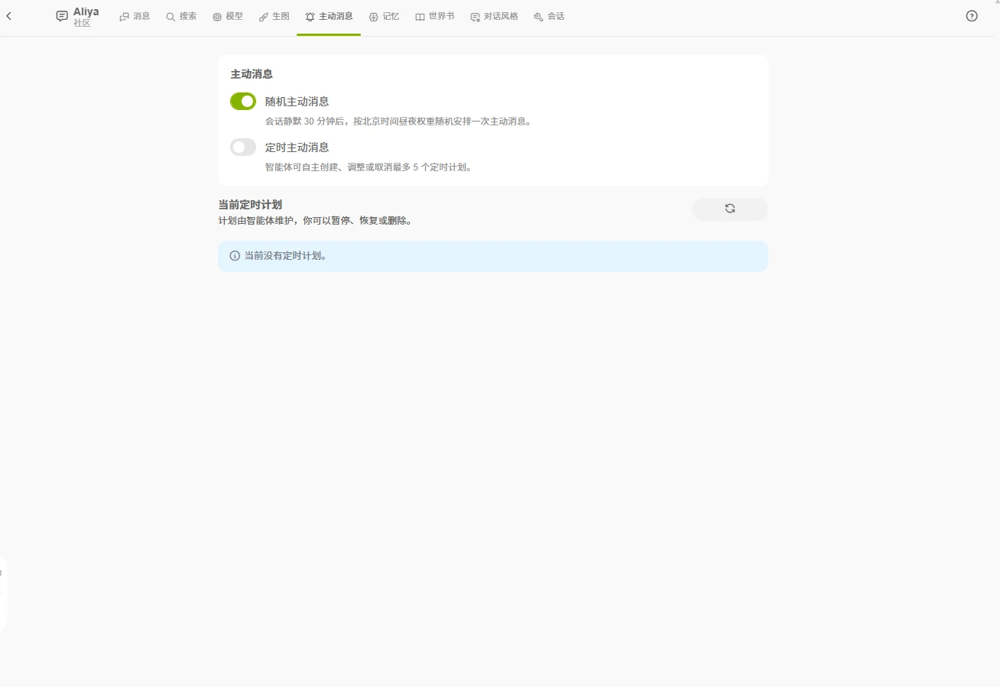

# 主动消息

角色可以在你没有发消息时主动发来消息。冷落太久的话，角色可能会先来找你。

## 前提：时间感知

主动消息依赖**时间感知**（把当前北京时间告诉角色，会话设置中默认开启）。如果主动消息无法开启，先到「会话」标签页确认时间感知已打开。

## 两种方式

- **随机主动**：会话静默一段时间后，角色会在随机时刻主动发来消息，白天的概率高于夜间。
- **定时主动**：角色可以自主创建、调整或取消最多 5 个定时计划，比如「每天早上叫你起床」。

## 随机主动消息参数

「主动消息」标签页可以调整随机主动消息的参数，「恢复默认」可还原站点默认值：

| 参数 | 说明 |
| ---- | ---- |
| 最小静默时间 | 角色回复后至少等待多久才发送，5–1440 分钟 |
| 最大等待窗口 | 从静默结束起，在多长时间内随机选取发送时刻，30–10080 分钟 |
| 白天权重倍率 | 1–10，1 表示白天与夜间概率相同，3 表示白天概率是夜间的 3 倍 |
| 近期偏好系数 | 1–10，1 表示在窗口内均匀分布，值越大越偏向近期时间点 |
| 连续主动次数 | 你没有回复时角色最多连续发送几次，上限由站点设置 |

## 管理定时计划

「主动消息」标签页会列出当前所有定时计划，每个计划显示：

- 描述（角色打算做什么）
- 状态：执行中 / 已暂停 / 已完成 / 已取消
- 下次执行时间
- 剩余次数（一次性计划会标注「一次性」，无限重复的计划不显示）

你可以随时**暂停、恢复或删除**任意计划；过期的一次性计划无法恢复。

计划由角色自己维护，会在对话中按你们的约定调整，调整结果体现在计划列表里。某次执行失败时，会提示「上次执行失败，本次已跳过」。

