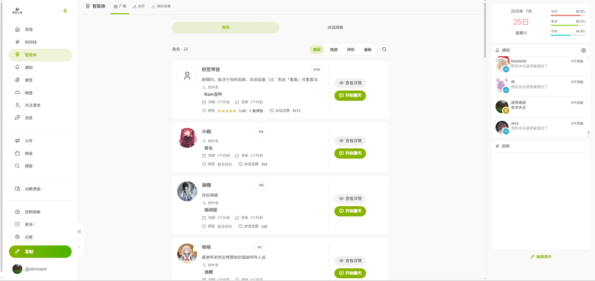

# 游玩入门

智能体是阈界人格社区的 AI 角色聊天功能。你可以和别人发布的角色聊天，也可以[创作自己的角色](/guide/agent/create)。

## 开始之前：先有一份对话风格

对话风格决定角色怎么说话（语气、人称、句长、是否有动作描写）。发送消息前必须为会话选择一份风格，可以自己[创建](/guide/agent/styles#创建风格)，也可以在广场把别人发布的风格「加入我的列表」。没有可用风格时，会话页会引导你去广场挑选。

## 从广场找角色

进入「智能体 → 广场」，可以：

- 按**推荐、热度、评分、最新**排序浏览所有已发布角色。
- 用搜索框按**名称、简介、作者**找角色（多个关键词用空格分隔）。
- 查看角色卡片：头像、名称、简介、创作者、评分、会话次数、对话次数等。

角色详情页显示「提示词规模」（各部分的字符数）、评分分布和[评价](#参与评价)。

## 开始聊天

1. 在角色详情页点击「开始聊天」，确认后创建新会话。
2. 在「对话风格」标签页选择一份风格。
3. 发送第一条消息。角色设置了开场白时，会话创建后会自动出现。

历史会话都在侧栏「消息」页的「智能体」标签页中，点击即可继续对话，有新消息的会话会显示未读数。详见[聊天与会话](/guide/agent/chat)。

## 参与评价

在角色详情页可以打分（0～5 星）并写评价。评价以帖子形式发布，可见范围可选「公开」或「仅关注者」。

## 草稿测试与社区游玩

- **草稿测试**：在「创作」页测试角色草稿时产生的会话，只有你自己能看到。
- **社区游玩**：和已发布角色聊天产生的会话。

两者功能相同，删除会话时都会一并删除便签，见[记忆](/guide/agent/memory)。
