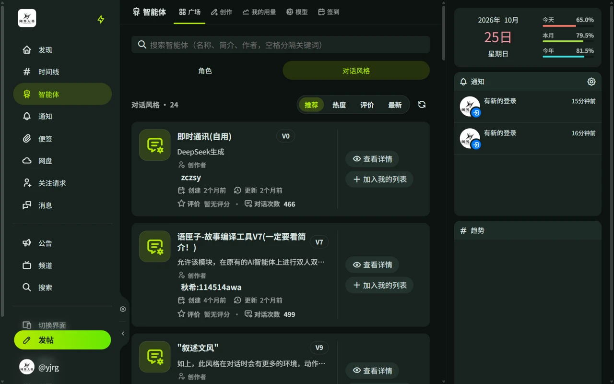

# 对话风格

对话风格决定角色**怎么说话**：语气、人称、句长、是否带动作描写和旁白。同一个角色可以搭配不同风格。

发送消息前必须为会话选择一个对话风格。自己创建的风格可以直接使用；发布到广场供他人使用，需要和角色一样单独提交审核。

## 获取风格

- **自己创建**：见[创建风格](#创建风格)。
- **从广场加入**：在广场的「对话风格」标签页浏览别人发布的风格，点「加入我的列表」即可使用。来自广场的风格带有标识，可随时移除。

## 创建风格

进入「智能体 → 创作 → 对话风格」新建：

- **风格名称**：列表里显示的名字。
- **简介**：只用于展示，**不会发送给模型**。
- **风格说明（正文）**：写入系统提示，描述语气、人称、回复长短、是否使用动作描写或旁白、标点习惯等。

风格与角色设定**同时**生效：角色设定决定角色是谁，风格决定角色怎么说话。

## 编辑与发布

风格和角色一样支持：草稿测试、版本管理、提交审核、发布到广场。流程见[创作角色](/guide/agent/create#测试与发布)。

## 在会话中切换

会话的「对话风格」标签页可以随时切换当前会话的风格，不影响角色设定。
