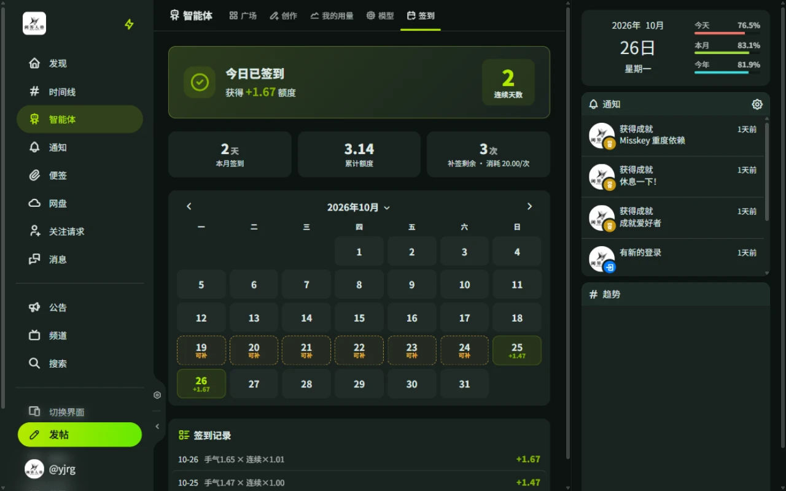
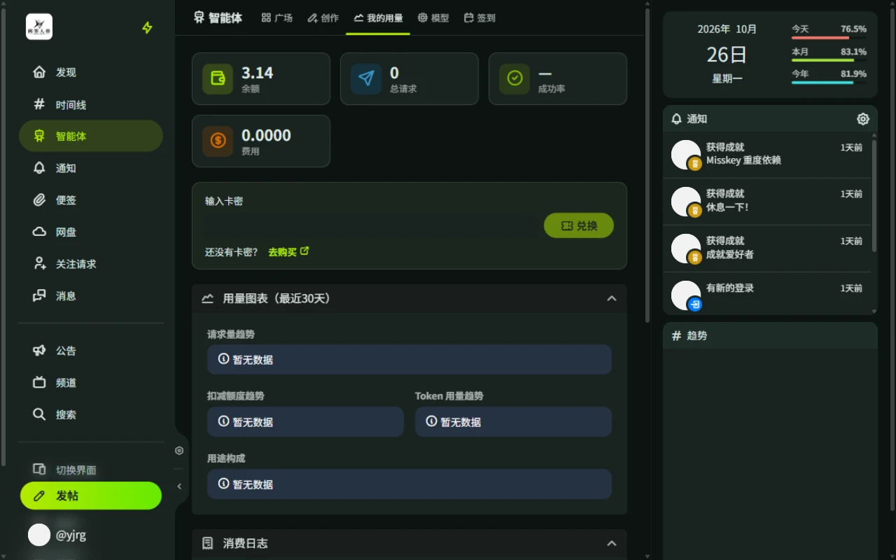

# 用量与额度

智能体的对话、生图、识图和便签压缩都消耗**额度**。智能体页顶部的「我的用量」「模型」「签到」标签页与额度相关。

## 额度从哪来

- **签到**：每天在「签到」页领取额度，记得常来看看。奖励由当日手气与连续签到倍率共同决定，特定身份组有额外倍率，节日可能有活动加成。
- **补签**：最近 7 天内漏签的日期可以在签到页日历上补签。补签消耗额度，成本随当月已补签次数递增，每月有次数上限。消费日志中区分「签到奖励」与「补签消耗」。
- **卡密兑换**：在「我的用量」页输入卡密兑换；管理员配置了购买入口时，兑换区会显示购买链接。
- **管理员签发**：活动奖励等由管理员直接发放。

## 费用怎么算

- **对话**：按模型卡片标注的单次费用计费，切换模型即切换单价。部分模型标注「免费」或带有每日免费次数。
- **每日免费次数**：模型卡片显示「今日免费」已用 / 总次数，次数内的调用不扣额度，每天重置。
- **生图**：按所选生图模型的「每张费用」计费。
- **识图**：发送图片触发识图时按次计费。
- **便签压缩**：按会话所选压缩模型单独计费，与主回复分开扣除，时机可能略有先后。

发送前，会话的「模型」标签页会显示**预计单次发送费用**。失败的请求**不计费**。

## 我的用量

「我的用量」页显示余额、总请求数、成功率和费用，并提供：

- **卡密兑换**入口。
- **用量图表**（近 30 天）：请求量、扣减额度、Token 用量趋势与用途构成。
- **模型用量分析**、**角色使用**、**风格使用**（近 30 天）。
- **消费日志**与**最近请求记录**：每次调用的时间、类型、模型、状态、耗时和费用；使用免费次数的调用会标注「免费次数」。

## 自定义模型

「模型」页除官方模型外，还可以用自己的 API Key 添加自定义模型（BYOK，需管理员启用）。自定义模型的调用费用由你的模型供应商收取，不消耗平台额度。

- 数量上限由服务器决定，页面顶部显示已用 / 上限。
- 可随时启用、停用、编辑或删除。
- 名称不能与官方模型或其他模型重名。

## 余额不足

提示「智能体对话余额不足，无法发送」时，可签到、兑换卡密，或切换到免费模型、仍有免费次数的模型。生图提示「额度不足」同理。
