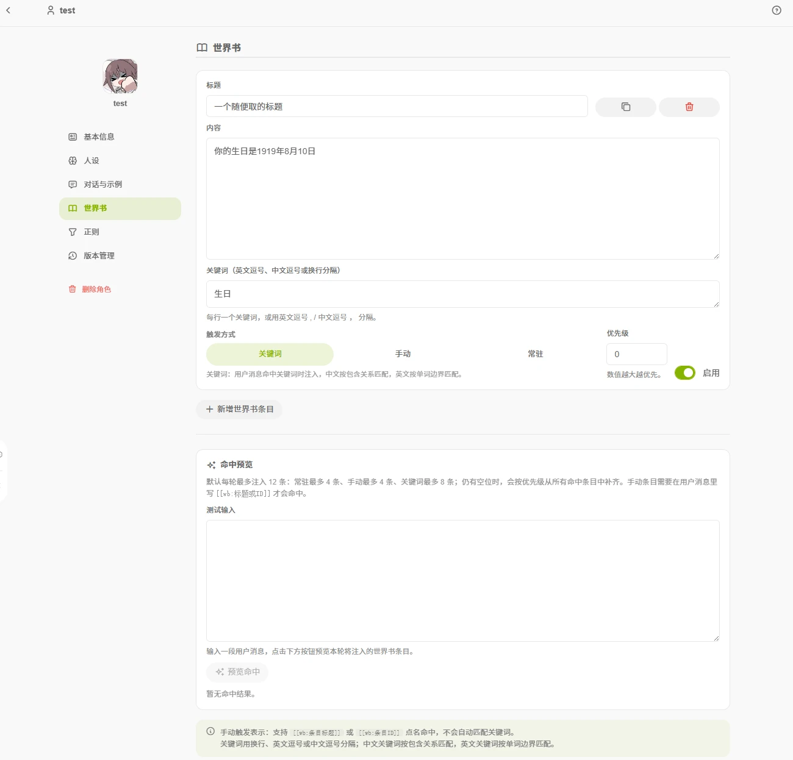

# 世界书

世界书是角色的**背景知识库**，存放世界观、地点、组织、人物关系、历史事件、专有名词等设定。条目**按需注入**，只有命中的条目才会发送给模型。

## 条目字段

- **标题**：条目的名字，手动触发时使用标题或条目 ID。
- **内容**：具体的设定文字。
- **关键词**：触发该条目的词，用换行、英文逗号或中文逗号分隔。
- **触发方式**：见下。
- **优先级**：数值越大越优先注入。
- **启用**：开关，关闭后不参与注入。

条目支持新增、复制、删除。

## 三种触发方式

| 方式 | 何时注入 |
| ---- | -------- |
| 关键词 | 用户消息中出现关键词时。中文按包含关系匹配，英文按单词边界匹配 |
| 手动 | 消息里出现 `[[wb:条目标题]]` 或 `[[wb:条目ID]]` 时 |
| 常驻 | 每轮对话都参与注入 |

## 命中规则

每轮对话最多注入 12 条：

- 常驻最多 4 条
- 手动最多 4 条
- 关键词最多 8 条

未满 12 条时，按优先级从其余命中的条目中补齐。

## 命中预览

编辑页的「命中预览」可以输入一段测试消息，查看实际会注入的条目及其触发方式、优先级和命中的关键词。手动条目旁有插入按钮，可以把 `[[wb:标题]]` 插入测试消息。

## 与记忆的分工

世界书由创作者编写，所有用户看到的内容相同；[记忆](/guide/agent/memory)按会话独立，记录每个会话自己的对话内容。
