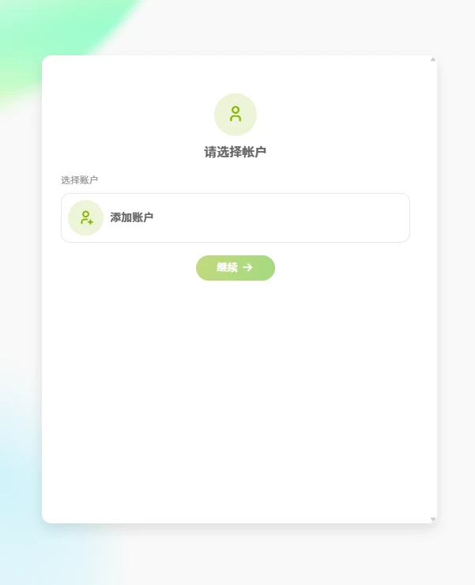
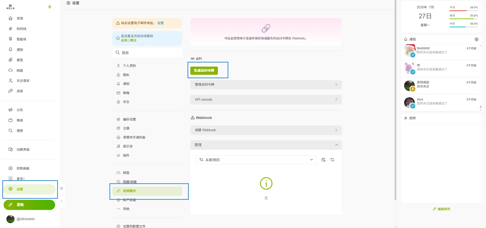
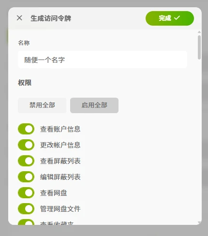
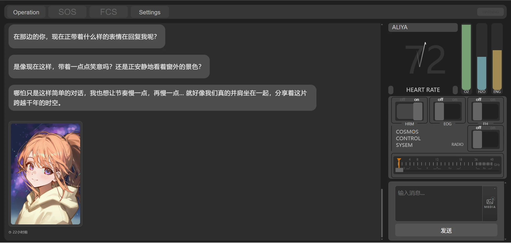
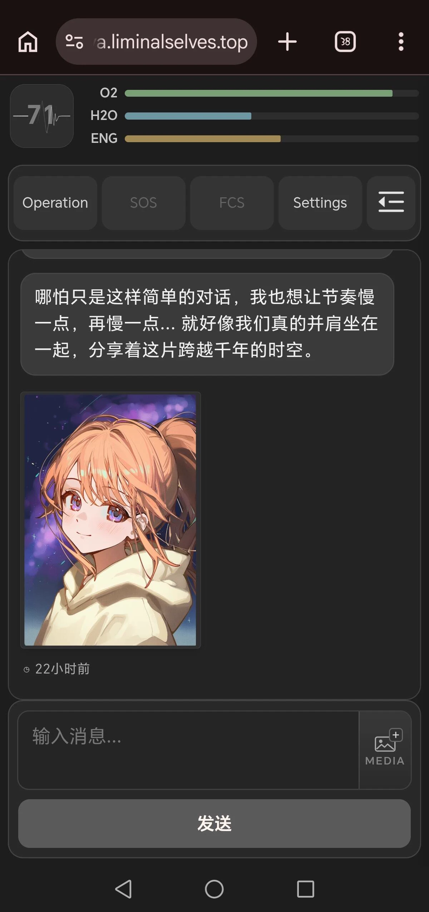
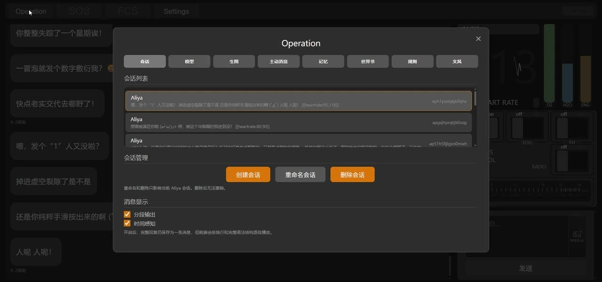

# Aliya Web

Aliya Web 是阈界人格项目组的另一个项目：基于社区智能体的 Aliya 聊天终端，界面仿照原版游戏，电脑和手机都可以使用。地址：<https://aliya.liminalselves.top>

## 登录说明

首次使用需要通过社区授权或填写访问令牌登录，**推荐授权登录**。进入站点后按提示跳转到授权页面，选择自己的账号即可。列表中没有自己的账号时，点击「添加账户」并输入账号密码登录。

也可以用访问令牌登录，一般用户不推荐。在社区网页端依次点击 **设置 → 连接服务 → 生成访问令牌**，启用全部权限后复制令牌：

回到 Aliya Web 的登录界面粘贴令牌即可。

::: warning
访问令牌具有账号的完整访问权限，请妥善保管。若不慎泄露，参照[常见问题](/guide/faq#访问令牌泄露了怎么办)立即删除。
:::

## 使用说明

登录后点击「连接」进入聊天界面。电脑端界面：

手机端界面：

顶栏的 **Operation** 和 **Settings** 是两个设置入口。

### 聊天窗口

分为消息区、面板区和输入框：

- **消息区**：显示消息、贴纸和图片，支持 Markdown 和部分特效（如 `$[x2 放大]`）。全站表情 `:名字:` 内联显示，角色专属贴纸单独占一行。图片可点击放大、滚轮缩放，向上滑动自动加载历史消息。
- **面板区**：仿驾驶舱的装饰面板。心率是 Aliya 的实时心率，随她的回复波动；氧气值随时间消耗，每 50 小时一个周期，降到 10% 时 Aliya 会自己打开制氧机补满，不用担心她憋着～
- **输入框**：支持多行输入；点击 MEDIA 图标可以上传图片文件。

### Operation：主设置窗口

点击顶部 **Operation** 打开设置窗口，包含**会话、模型、生图、主动消息、记忆、世界书、规则、文风**标签页：

- **会话**：点击列表中的会话即可加载，可新建、重命名或删除会话，**删除不可恢复**。新会话至少发送一条消息后才会出现在列表中。消息显示异常时，重新切换一次会话通常可以恢复。下方有两个开关：
  - **分段输出**：Aliya 的回复按换行和完整语法结构逐段显示。
  - **时间感知**：把当前北京时间告诉 Aliya，[主动消息](/guide/agent/proactive)依赖此开关。
- **模型**：同[模型](/guide/agent/chat#模型)。
- **生图**：同[生图](/guide/agent/chat#生图)。
- **主动消息**：同[主动消息](/guide/agent/proactive)，主动消息会实时出现在聊天窗口中。
- **记忆**：同[记忆](/guide/agent/memory)，可开启便签压缩并管理便签。
- **世界书**：同[世界书](/guide/agent/worldbook)。
- **规则**：同[规则](/guide/agent/rules)。
- **文风**：即[对话风格](/guide/agent/styles)，列出你创建和加入的风格，点击即可切换。

### Settings

点击顶部 **Settings** 打开设置面板：

- **鉴权 Token**：粘贴新 Token 后点击「保存」或按回车即可验证并生效，留空则保持当前 Token。
- **背景音乐**：内置多首曲目，选「不播放」可关闭。
- **播放模式**：单曲循环 / 随机播放 / 列表循环。

## 遇到异常

- 提示「休息一下马上恢复」或 429 错误：见[常见问题](/guide/faq)，稍等即可恢复。
- 面板提示加载失败或鉴权失败：在 Settings 中重新保存一次 Token。
