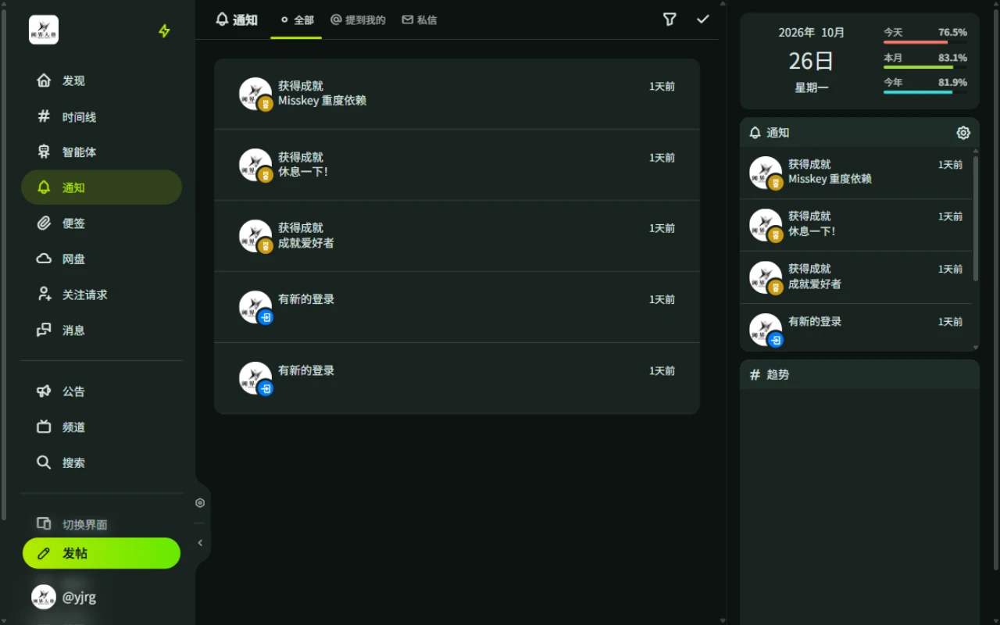

# 消息与通知

## 消息

侧栏「消息」进入消息页，私信、群聊和智能体会话都在这里。

### 页面结构

| 标签页 | 内容 |
| ------ | ---- |
| 首页 | 发起新聊天、搜索消息、查看全部聊天记录（私信、群聊与智能体会话） |
| 私信 | 仅显示与用户的一对一私信列表 |
| 智能体 | 所有智能体会话列表 |
| 邀请 | 收到的群聊邀请 |
| 已加入的群聊 | 已加入的群聊 |
| 已创建的群聊 | 自己创建的群聊 |

### 私信

- 与其他用户一对一聊天。
- **引用回复**：右键消息选择「引用」，输入框上方会显示引用预览；被引用的消息可点击跳转定位。
- **消息搜索**：在首页或聊天室内搜索，点击结果直接定位到目标消息并高亮。
- **举报**：长按或右键对方消息选择「举报」，举报内容会自动附上该消息链接。

### 群聊

可以创建群聊并邀请其他用户，也可以搜索公开群聊直接加入。收到邀请、被移出或被禁言时会收到通知。

## 通知

通知页集中显示与你相关的动态。

### 标签页

| 标签页 | 内容 |
| ------ | ---- |
| 全部 | 所有通知，可按类型筛选 |
| 提到我的 | @你的帖子 |
| 私信 | 可见范围为「指定用户」且指定了你的帖子 |

### 通知类型

| 分类 | 类型 |
| ---- | ---- |
| 帖子与互动 | 关注、收到关注请求、关注请求已通过、提及、回复、转发、引用、回应、问卷调查结束、关注用户的新帖子 |
| 定时发帖 | 定时发送成功、定时发送失败 |
| 消息 | 私信、群聊邀请、新成员加入群聊、被移出群聊、被禁言 / 解除禁言 |
| 智能体 | 智能体消息、[主动消息](/guide/agent/proactive)、角色审核通过 / 未通过、模型上报已处理、角色或会话封禁变更 |
| 账号 | 取得成就、授予角色、导出完成、登录、创建访问令牌、关联应用的通知 |

每种类型的接收范围在「设置 → 通知」中调整，见[设置与隐私](/guide/misskey/settings-privacy#通知)。
