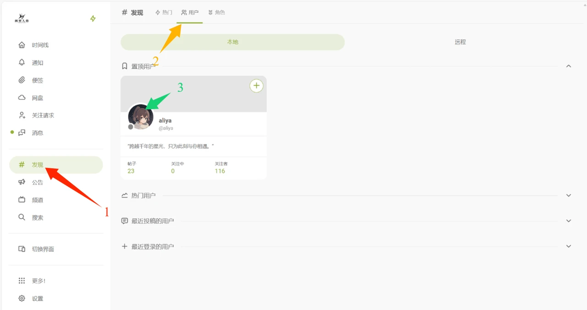
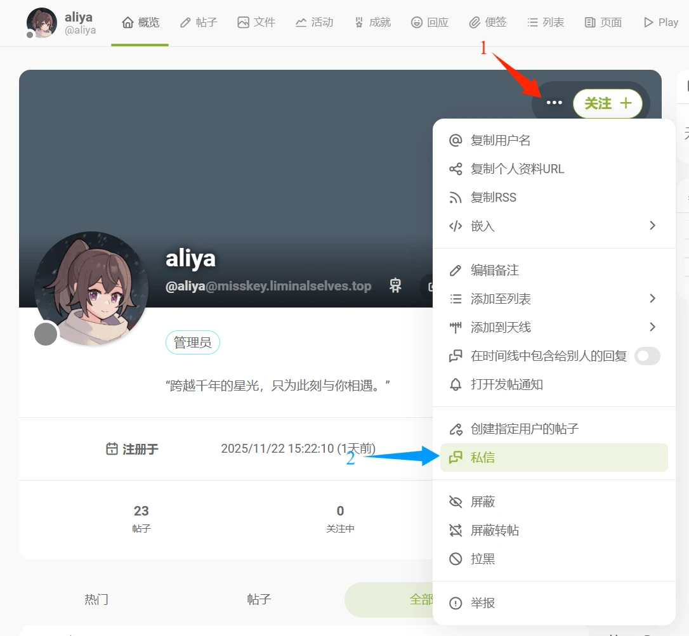
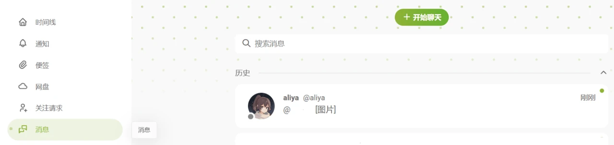
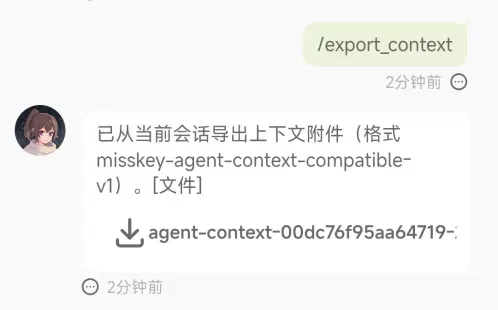
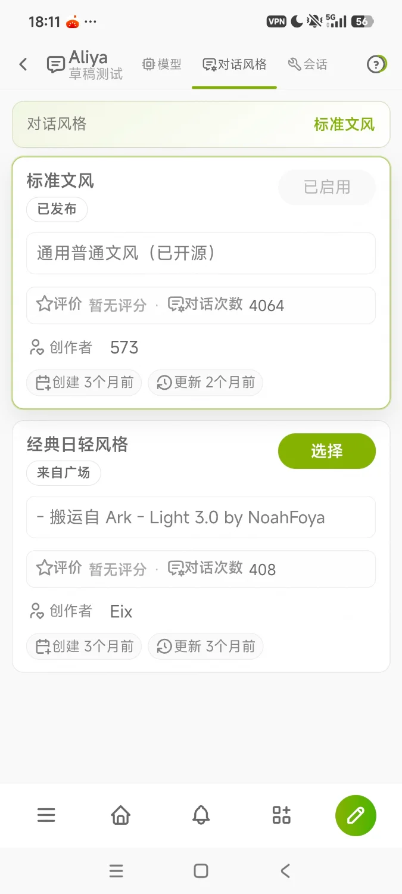
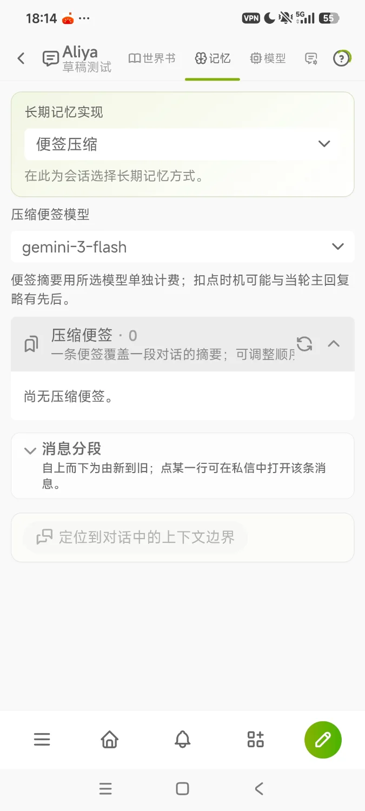
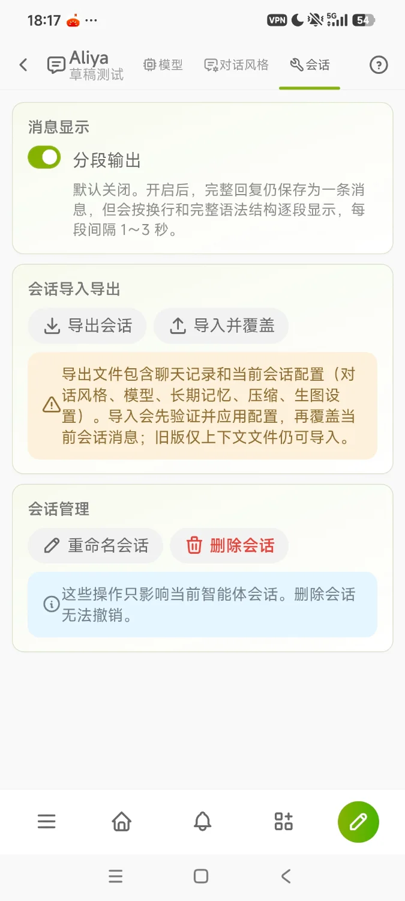
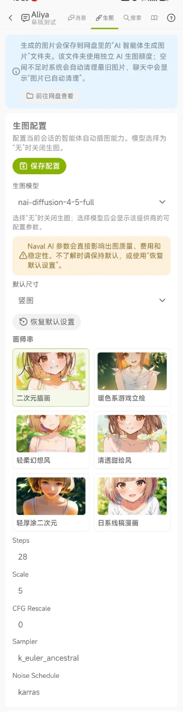

# 从旧版 Aliya Bot 迁移

本页面向旧版 Aliya Bot 的用户。旧版的剩余额度和聊天记录都可以迁移到社区智能体，见[额度迁移](#额度迁移)和[聊天记录迁移](#聊天记录迁移)。

## 发起私信

旧版 Aliya Bot 通过私信使用。第一次私信时，在社区网页端依次点击 **发现 → 用户 → 用户头像**。

对方的隐私设置要求先关注才能私信，因此先点「关注」，再点右上角「…」→「私信」。

之后在侧栏「消息」中即可再次进入聊天。

## 常用指令

### 会话相关

- `/ls`：查看对话列表。
- `/new`：创建新对话，原对话保留。
- `/rename 文字`：重命名当前对话。
- `/switch 序号`：切换到指定对话，序号为对话名称前的数字。
- `/del`：删除当前对话，**不可恢复**。

### 功能相关

- `/ch 数量`：遗忘最近若干轮对话，不填数量时为 1。
- `/hg`：查询 Aliya 对你的好感度。
- `/xf`：修复当前对话。
- `/yh`：对话质量较低时开启优化，再次发送关闭。开启后会增加 token 和额度用量。

以下指令带子命令，单独发送即可查看用法：

- `/draw`：查询、更改画图设置。
- `/model`：查询、更改对话模型和额度。
- `/rc`：查询日程提醒。
- `/time`：查询、修改你和 Aliya 的时间线。

## 额度迁移

向 Aliya Bot（不是智能体中的 Aliya 角色）发送 `/credits_transfer`，剩余额度会一次性转入智能体余额。

迁移记录可在「智能体 → 我的用量 → 消费日志」中查看，见[用量与额度](/guide/agent/usage#我的用量)。

## 聊天记录迁移

把 Aliya Bot 的聊天记录导入智能体的 Aliya 角色。

### 1. 导出聊天记录

向 Aliya Bot 发送 `/export_context` 指令，下载聊天记录文件。

### 2. 创建新会话

在「智能体 → 广场」找到 Aliya 角色，点击「开始聊天」，创建新的会话。

{.phone-shot}

::: warning
请务必创建新会话，避免已有会话的聊天记忆被覆盖。
:::

### 3. 完成会话配置

在新会话顶部的标签页中依次完成以下配置。

**① 选择对话风格**：任意社区风格均可。如果列表里没有可选的风格，先到「智能体 → 广场 → 对话风格」添加，见[对话风格](/guide/agent/styles)。

{.phone-shot}

**② 开启记忆**：在「记忆」标签页选择长期记忆方式，推荐「便签压缩」。模型的上下文长度有限，不开启记忆时，超出上下文的旧对话不会再发给模型。详见[记忆](/guide/agent/memory)。

{.phone-shot}

**③ 开启分段输出**（可选）：在「会话」标签页打开「分段输出」。

**④ 导入聊天记录**：在「会话」标签页点击「导入并覆盖」，上传第 1 步下载的文件。导入会覆盖当前会话的消息。

{.phone-shot}

**⑤ 开启生图**（可选）：在「生图」标签页选择生图模型，角色回复时会附带插图。「画师串」用于切换画面风格。详见[生图](/guide/agent/chat#生图)。

{.phone-shot}

## 遇到问题

- **手机端找不到导出的文件**：将 App 更新到最新版本，在系统文件管理的 **Download** 文件夹中查找新增的 JSON 文件。
- 其他问题可以[联系项目组](/guide/faq#联系项目组)。
