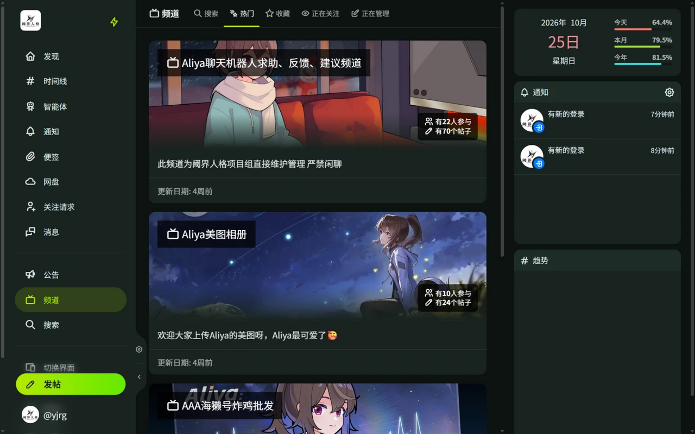

# 频道

频道是围绕特定主题的公共讨论区，每个频道有独立的时间线。

## 浏览频道

通过侧栏「频道」进入频道列表：

- **搜索**：按名称或名称与描述搜索频道。
- **热门**：当前活跃的频道。
- **收藏**：你收藏的频道。
- **正在关注**：你关注的频道。
- **正在管理**：你创建的频道。

每个频道显示参与人数和帖子数。进入频道后，「热门」标签页展示该频道的热门帖子，右上角刷新按钮可换一批内容。

## 关注与发帖

- 关注频道后，频道新帖会出现在你的时间线中，并标注来源频道。
- 在频道内发的帖子只投递到频道，不进入「首页」时间线。
- 发帖时也可以在发帖窗口中选择投稿到指定频道。
- 频道帖子默认允许转发到频道外和引用，频道管理者可以关闭。

## 创建频道

点击「创建频道」，填写名称、描述和横幅图即可创建。创建者成为频道管理者，可以编辑频道信息、管理频道帖子。
