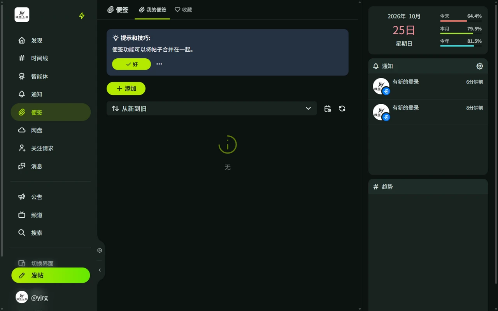

# 便签与收藏

便签和收藏都用来保存帖子：便签可以分类并公开，收藏只有自己可见。

## 便签

便签（Clip）是自建的帖子合集：

- 通过侧栏「便签」创建合集，例如「同人图存档」「灵感记录」，可填写名称和描述。
- 在帖子菜单中选择「便签」，把帖子加入合集。
- 便签可以设为**公开**并分享链接，也可以保持私有。
- 可创建的便签数量和每个便签可收录的帖子数由服务器策略决定，上限为 0 时无法新建便签。

## 收藏

收藏（Favorites）是不分类的收藏夹：

- 在帖子菜单中选择「收藏」，帖子进入「收藏」列表，再次选择可取消。
- 收藏列表只有自己可见，适合标记以后再看的帖子。

需要按主题整理或分享给别人时用便签，只想留个记号时用收藏。
