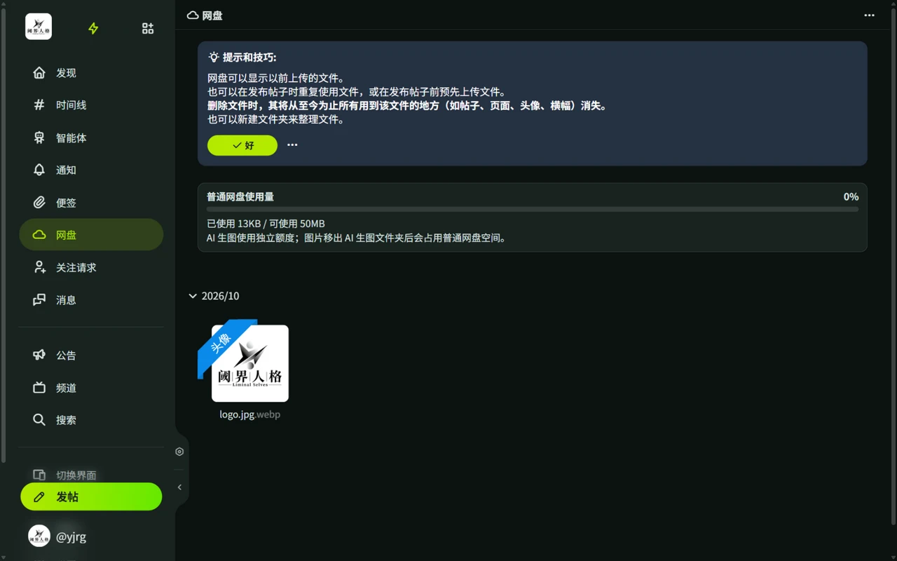

# 网盘

网盘（Drive）保存你上传的所有文件，发帖上传的图片、视频都在这里，可以重复使用。

## 管理文件

- 通过侧栏「网盘」进入，可新建文件夹、移动、重命名、删除文件。
- **框选与拖拽**：电脑上从空白处按下拖动可框选多个文件；手机上长按文件后拖动可移入文件夹，长按空白处可框选。
- 进入子文件夹后，浏览器返回键可逐级返回上一层。
- 点击文件可查看文件信息和引用了该文件的帖子。
- 文件可标记为**敏感内容**，在时间线中默认折叠显示。
- 单个文件可以在不同帖子中重复引用。删除文件后，引用处显示「已被清理」占位卡片，并标注文件原主人。

## 图片装饰

- **添加边框**：为图片加边框和元数据标签。
- **添加水印**：为图片叠加水印。

## 容量与清理

- 总容量、单个文件大小上限和可上传的文件类型由服务器策略决定。
- 「设置 → 网盘」：查看容量与使用量统计，设置默认上传文件夹、上传时默认压缩等级、是否保留原文件名、总是标记为敏感内容、自动检测敏感内容，以及默认边框和水印预设。
- 「网盘清理」：按文件大小或创建时间排序列出文件，便于批量删除。
- 第三方客户端上传、下载文件出问题时，改用浏览器访问网站操作。
