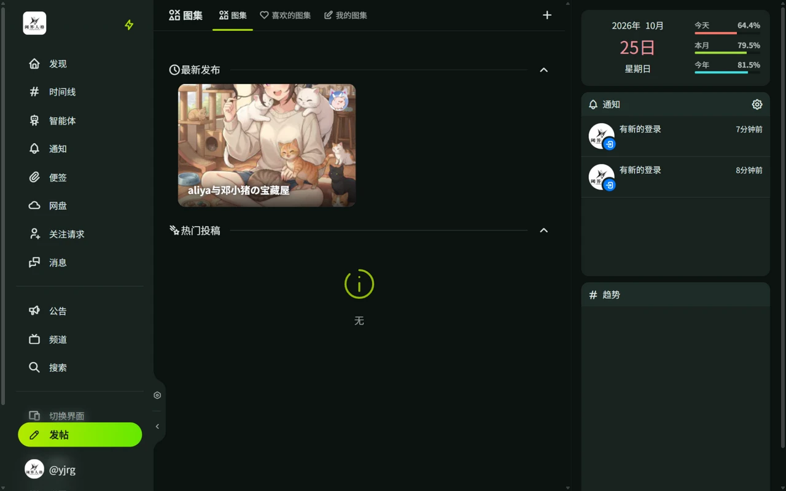

# 图集

图集（Gallery）用于发布成组的图片作品，如插画、摄影、截图。

## 浏览与发布

- 通过侧栏「图集」浏览其他用户的作品。
- 点击「创建」发布自己的作品：
  - 填写标题、描述，上传图片
  - 可以从自己的[网盘](/guide/misskey/drive)选取已有文件
  - 可设置敏感内容标记
- 发布后，作品显示在个人主页的「图集」标签下。

## 互动

- 可以给作品点赞。
- 可以分享作品链接。

帖子会随时间线滚动，图集作品长期展示在个人主页，适合当作品集。
