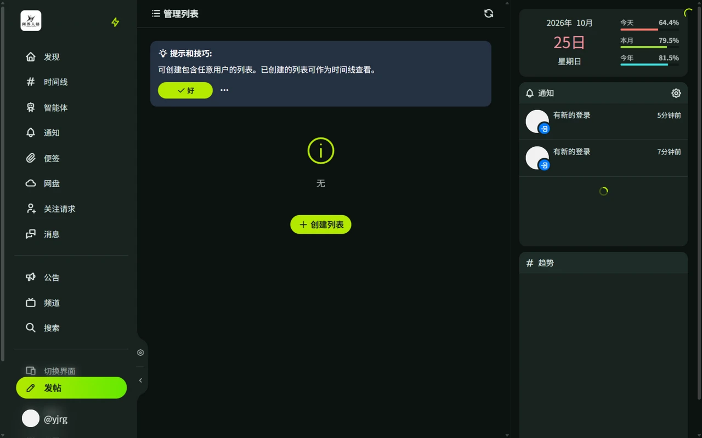
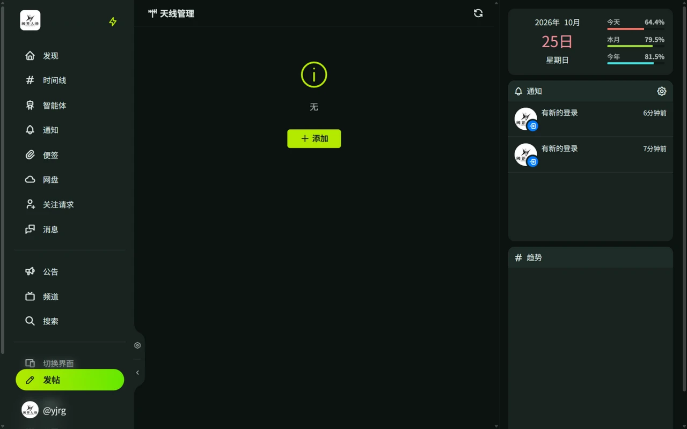

# 列表与天线

列表和天线是两种定制信息流的工具：列表按**人**组织，天线按**关键词**组织。

## 列表

列表（Lists）是自建的用户分组，列表时间线只显示组内用户的帖子，可选择是否包含回复。

- 通过侧栏「列表」创建，例如「好友」「画师」。
- 在[时间线](/guide/posts#时间线)中切换到列表查看。
- 列表只有自己能看到。
- 列表上限和每个列表的成员数上限由服务器策略决定。

## 天线

天线（Antennas）按条件自动收集帖子，例如追踪包含某个关键词的所有新帖。

- 通过侧栏「天线」创建，每个天线有独立时间线。
- 天线数量上限由服务器策略决定。
- 可设置的条件：

| 条件 | 说明 |
| ---- | ---- |
| 接收来源 | 所有帖子 / 已关注用户的帖子 / 来自指定用户 / 来自指定列表 / 过滤指定用户后的所有帖子 |
| 包含关键字 | 空格分隔为 AND，换行分隔为 OR |
| 排除关键字 | 规则同上，命中则不收录 |
| 其他 | 区分大小写、排除机器人账户、包含回复、仅带有附件的帖子、排除敏感频道的帖子 |

## 如何选择

想看**某些人**的动态用列表，想追踪**某类内容**（不论作者）用天线。
