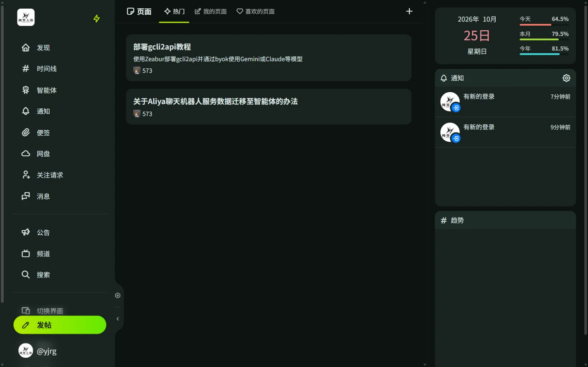
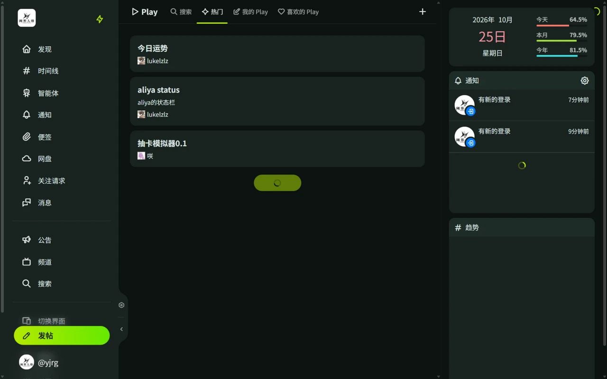

# 页面与 Play

页面用于发布静态图文，Play 用于发布互动小程序。

## 页面

页面（Pages）是独立的图文页面，适合发布长文、教程、设定集：

- 通过侧栏「页面」进入，点击「创建页面」。
- 编辑器按区块组织内容，如正文、图片、帖子引用。
- 可以设置标题、摘要、封面图和敏感标记。
- 页面有独立链接，发布后可随时编辑，也可以查看源代码。

## Play

Play 是用 AiScript 编写的互动小程序，可以做按钮、小测试、抽签、计算器等：

- 通过侧栏「Play」进入，可浏览热门 Play、管理自己的 Play。
- 点击「创建 Play」后编写脚本，设置标题、描述、封面。
- 可以给别人的 Play 点喜欢。
- Play 有独立链接，可以分享。

AiScript 的语法和示例见 [AiScript 官方仓库](https://github.com/aiscript-dev/aiscript)。
