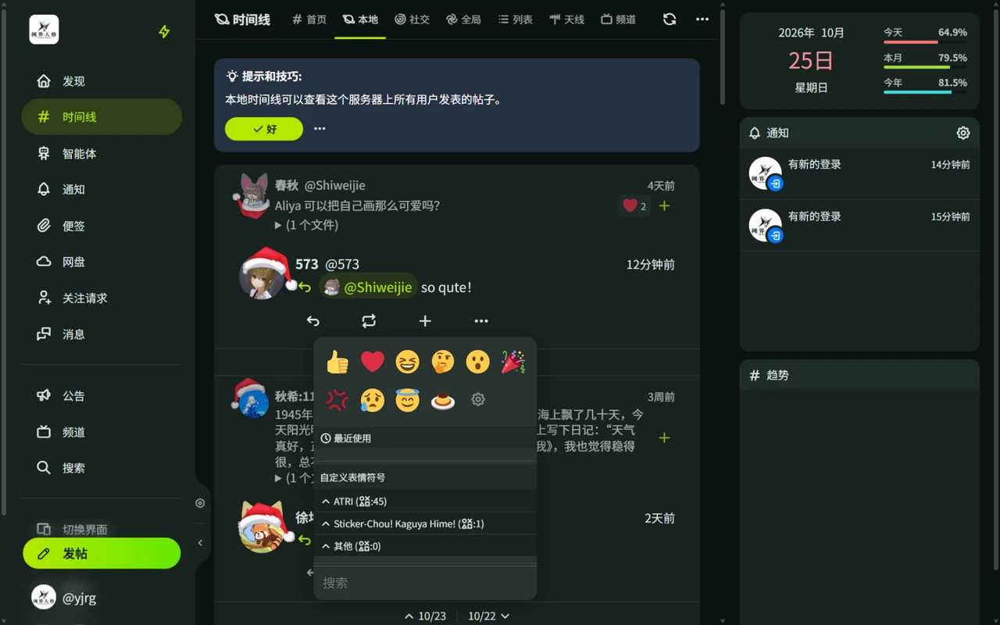

# 回应与表情符号

## 回应

回应（Reaction）是用任意表情回应帖子的互动方式，如 😂 😭 👍 ❤️ 或服务器的自定义表情。

- 点击帖子下方的 **+** 打开回应选择器，选一个表情即可回应。
- 点击帖子已有的回应可以查看回应者列表，再点一次自己发出的回应即可取消。

## 回应相关的设置

- **将回应设置为公开**（设置 → 隐私）：他人可以在你主页的「回应」标签看到你发出的回应。
- **接受表情回应**（设置 → 个人资料）：限制别人在你的帖子上可用的回应。

两项的完整说明见[设置与隐私](/guide/misskey/settings-privacy)。

## 表情符号调色板

发帖或回应时弹出的表情选择器：

- 包含 Unicode 表情和服务器自定义表情（`:名字:` 格式）。
- 在「设置 → 表情符号调色板」可以创建多个调色板，分别指定回应和发帖使用的调色板，并调整选择器的显示方式（弹出 / 抽屉）、大小和列数。

相关页面：[帖子互动](/guide/posts#互动)、[MFM 语法](/guide/misskey/mfm)。
