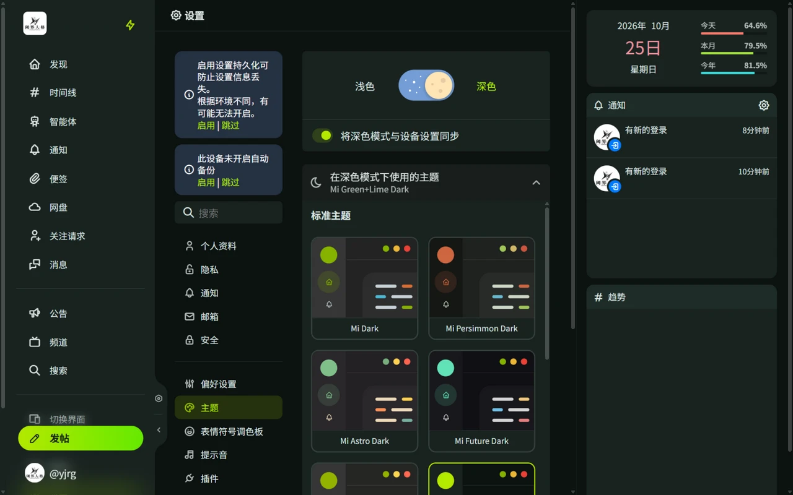

# 界面、主题与小工具

## 界面模式

Misskey 提供两种整体界面布局，在侧栏菜单「切换界面」中选择：

- **默认界面**：单列时间线 + 右侧信息栏，适合日常浏览。
- **Deck**：多栏布局，可以把首页时间线、列表、天线、通知等并排显示为多列，列可以自由添加、排列和调整宽度。

手机等窄屏下会自动切换为移动端布局。

## 主题

- 在「设置 → 主题」可以切换内置主题，本站默认为深色风格。
- 浅色、深色主题分别选择，可以跟随系统切换。
- 主题编辑器可以调整背景、强调色等。「安装主题」可以粘贴别人分享的主题代码，「管理主题」可以删除已安装的主题。

## 小工具

默认界面右侧栏（Deck 中为「小工具」列）可以放置小工具，进入编辑模式后添加、拖拽排列、单独配置。

| 分类 | 小工具 |
| ---- | ------ |
| 个人与社交 | 个人资料、通知、时间线、用户列表、私信、发帖窗口、今天是他们的生日、在线用户数 |
| 信息 | 服务器信息、趋势、活动、照片、RSS 阅读器、RSS Ticker、幻灯片展示 |
| 时间 | 日历、时钟、数字时钟、UNIX 时钟 |
| 工具与娱乐 | 便利贴、按钮、AiScript 控制台、AiScript App、小蓝、点击器 |
| 服务器状态 | 服务器指标、作业队列 |

## 导航栏与状态栏

- 「设置 → 导航栏」：调整左侧菜单显示哪些项目及顺序，可选完整显示或仅图标。可添加的项目还包括：查询（输入帖子或用户地址直接打开）、二维码（显示自己的二维码或扫码）、工具（草稿本、API Console、点击器）、重新加载、清除缓存等。
- 「设置 → 状态栏」：在页面顶部或底部常驻显示 RSS、用户列表动态等滚动信息。

## 声音与插件

- 「设置 → 声音」：为通知、回应等事件设置提示音。
- 「设置 → 插件」：安装 AiScript 插件扩展客户端功能（如自定义发帖后操作）。
- 「设置 → 自定义 CSS」：注入自定义样式调整界面。

::: warning
插件和自定义 CSS 可以读取或改变页面内容，只安装可信来源的代码。
:::
