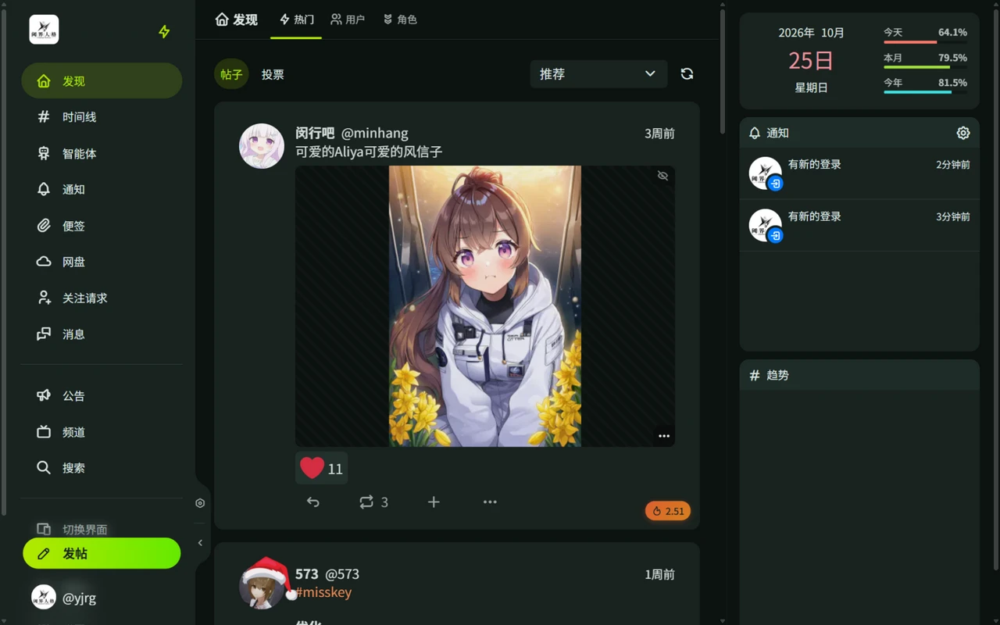
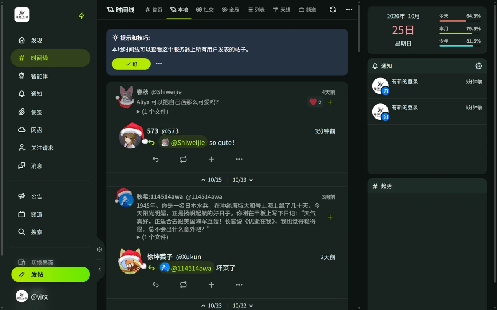
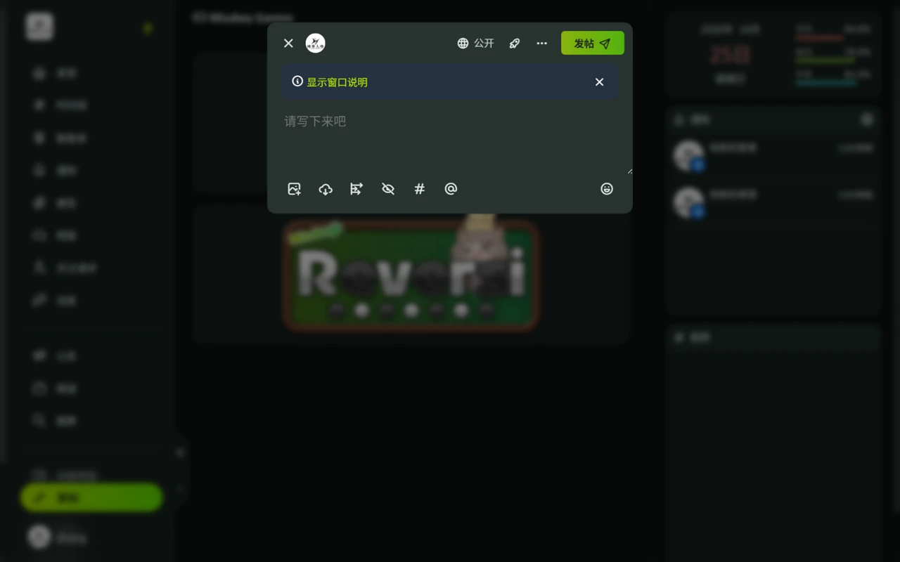
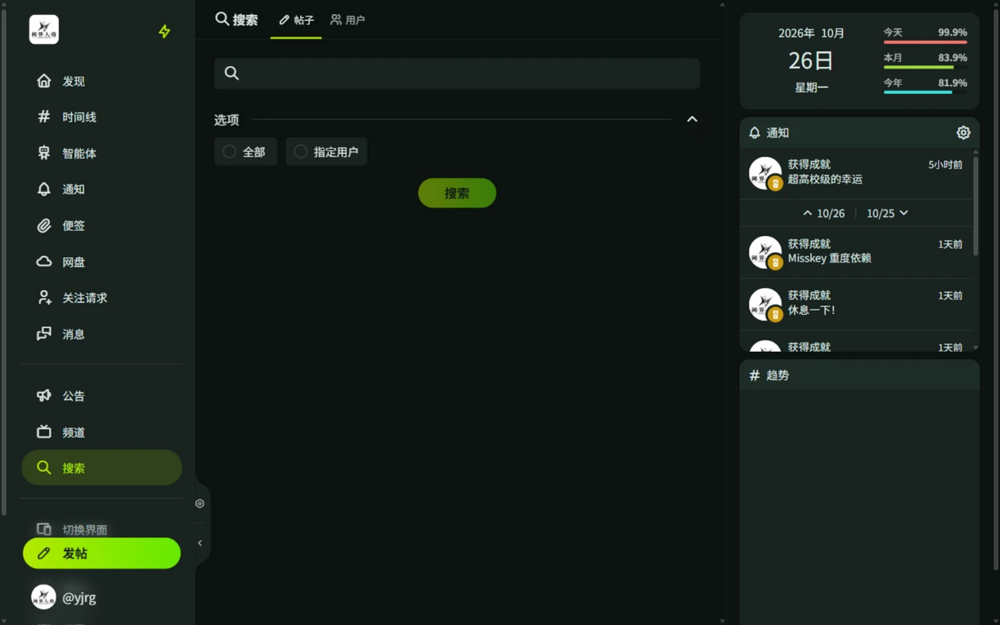
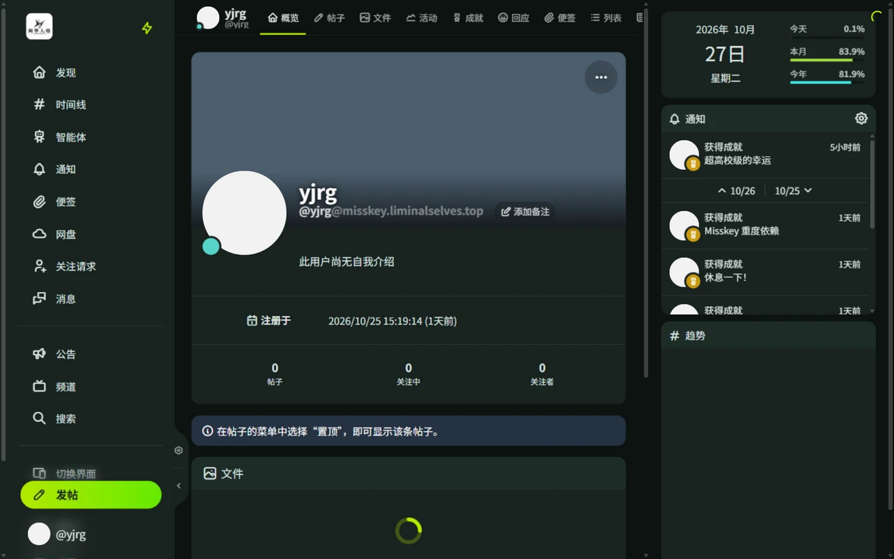

# 帖子与时间线

帖子可以包含文字、文件和投票。「发现」页展示社区热门内容，「时间线」展示关注的人或整个社区的动态。

在本站发帖还可以享受（？）来自 Aliya 的锐评。

## 发现

发现页是登录后的默认首页，展示社区里的热门内容。

- **热门**：分「帖子」「投票」两个板块，可按「推荐」「热度」「最新」排序，无限滚动加载；右上角刷新按钮可换一批内容。
- **用户**：发现社区活跃用户。
- **角色**：浏览服务器角色。

热度随时间衰减，「推荐」排序兼顾热门和新发布的内容。频道中的帖子也会出现在发现页，并标注来源频道。

## 时间线

时间线有以下几种：

| 类型 | 看到什么 |
| ---- | -------- |
| 首页 | 你关注的人发的帖子 |
| 本地 | 本服务器所有人的公开帖子 |
| 社交 | 首页 + 本地 合并 |
| 全局 | 所有公开帖子（本服务器不联合，内容与本地基本一致） |
| 列表 | 你自建的用户列表 |
| 天线 | 按关键词/用户订阅的内容 |
| 频道 | 特定频道的内容 |

可以筛选是否显示转发、回复，或只看带图片的帖子。新帖子实时出现，无需手动刷新。

列表与天线的用法见[列表与天线](/guide/misskey/lists-antennas)，频道详见[频道](/guide/misskey/channels)。

## 发帖

发帖窗口支持：

- **可见性**：公开、仅首页、仅关注者、指定用户
- **附件**：图片、视频等文件，可标记为敏感内容
- **投票**：创建投票
- **内容警告**：折叠正文，仅显示提示文字
- **定时发布**：在指定时间自动发出，可排队的数量由服务器策略决定，发出成功或失败都会通知
- **草稿**：保存后稍后继续编辑，数量上限由服务器策略决定
- **话题标签**：附加 #标签 方便他人发现
- **频道投稿**：发布到指定频道
- **引用与回复**：引用他人帖子附加评论，或直接在帖子下回复

正文支持 [MFM 语法](/guide/misskey/mfm)，可以加粗、加动画、改颜色。

## 互动

- **回应**：用任意表情回应，详见[回应与表情符号](/guide/misskey/reactions)
- **转发**：分享到自己的时间线
- **引用**：转发并附上自己的评论
- **回复**：参与讨论
- **收藏 / 便签**：保存喜欢的内容，详见[便签与收藏](/guide/misskey/clips-favorites)
- **分享 / 举报**：分享帖子链接，或向管理员举报

帖子右下角「…」菜单还提供：

| 菜单项 | 说明 |
| ------ | ---- |
| 翻译 | 翻译帖子正文 |
| 复制内容 / 复制链接 | 复制正文或帖子地址 |
| 嵌入 | 生成可嵌入其他网页的代码 |
| 静音帖文串 | 不再接收该帖子串的回复通知 |
| 置顶 | 仅自己的帖子，置顶到个人主页，数量上限由服务器策略决定 |
| 删除并编辑 | 仅自己的帖子，删除原帖并把内容带回发帖框重新编辑（原帖的回应和转发会丢失） |
| 删除 | 仅自己的帖子 |

## 搜索

侧栏「搜索」分「帖子」「用户」两个标签。

- **帖子**：按关键词搜索，可在选项中限定范围为「全部」或「指定用户」。
- **用户**：按用户名或昵称搜索。
- 输入 `#标签` 会跳转到对应话题标签页。

## 个人主页

点击头像进入用户主页，顶部标签依次为：概览、帖子、文件、活动、成就、回应、便签、列表、页面、Play、图集。

- 概览页显示简介、附加信息、注册时间、帖子数、关注与关注者，以及置顶的帖子。
- 「回应」标签只在对方开启「将回应设置为公开」时显示内容。
- 「…」菜单可以发私信、搜索该用户的帖子、开启新帖通知、加入列表或天线、隐藏（可选时长）、隐藏转发、屏蔽、举报和显示二维码。「添加备注」可以写只有自己可见的备注。

## 关注与关注请求

- 对方开启了「关注请求需要批准」时，关注会变成发送关注请求，对方同意后才生效。
- 侧栏「关注请求」分「收到的请求」「发送的请求」两个标签，在此同意、拒绝或撤回。

## 公告

侧栏「公告」展示服务器发布的公告，分「现在的公告」和「过去的公告」。有未读公告时会弹出提示，部分公告需要点击「我知道了」确认后才会消失。[社区规范](/guide/rules)也以公告形式发布。
